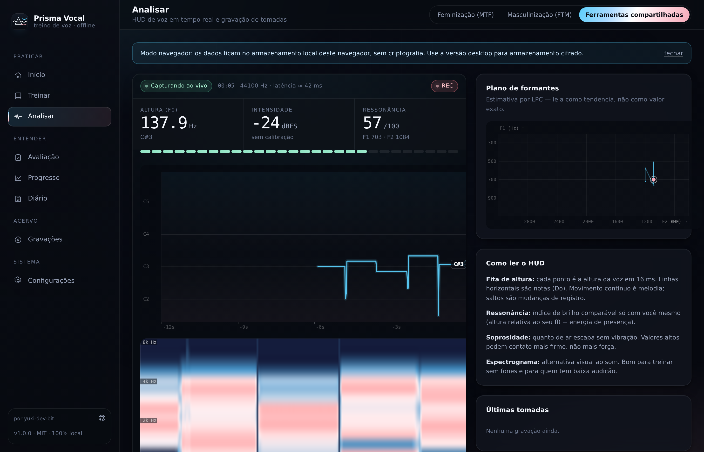
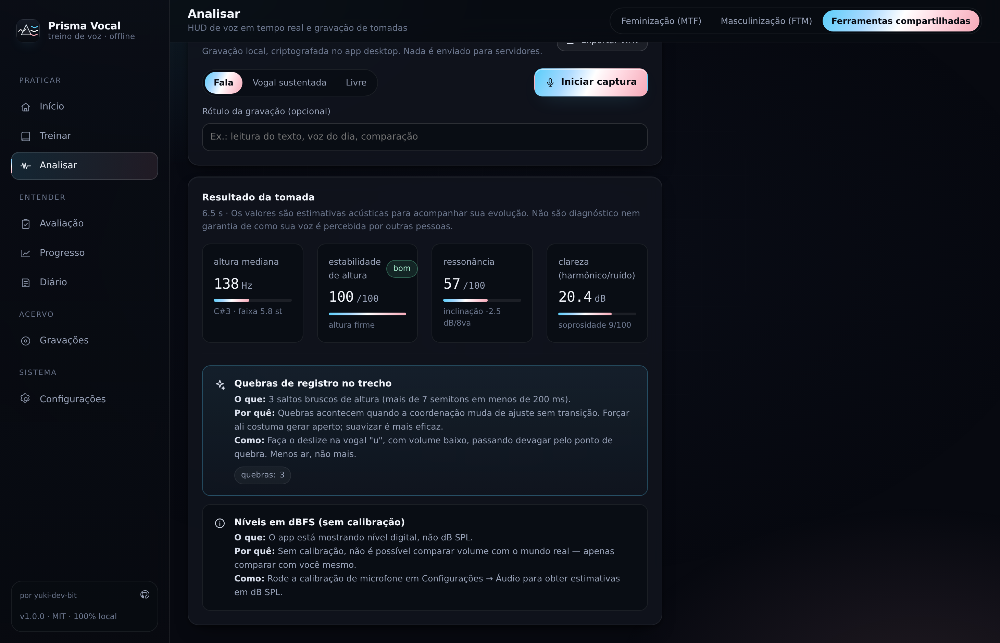
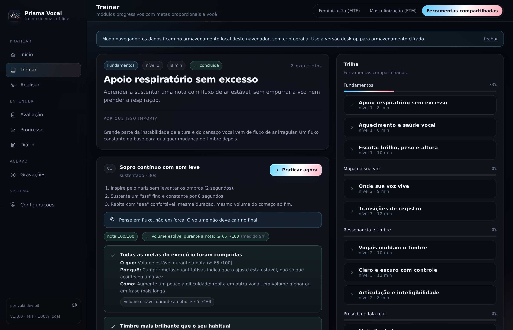
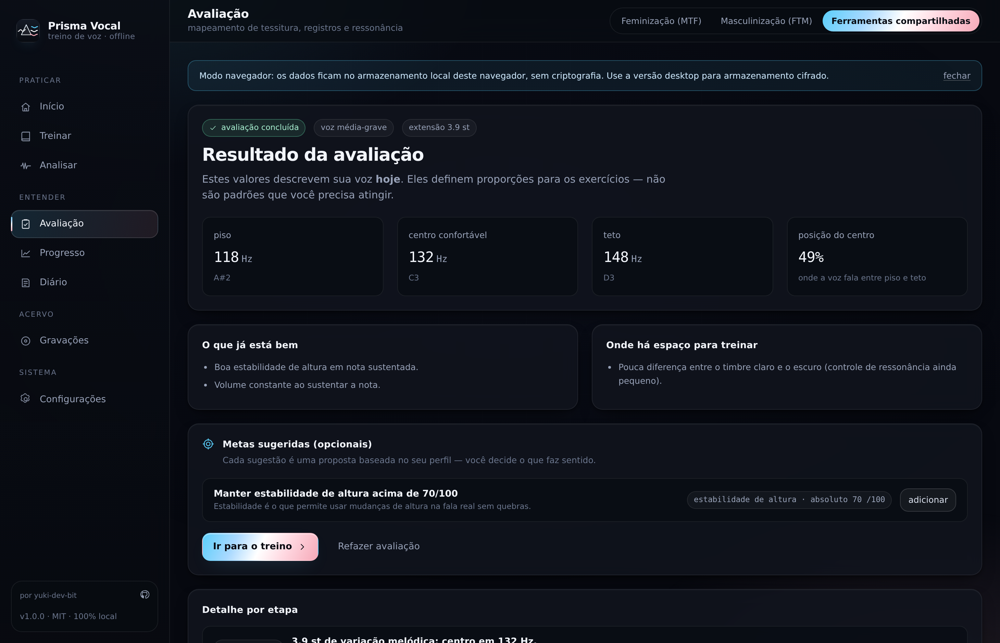
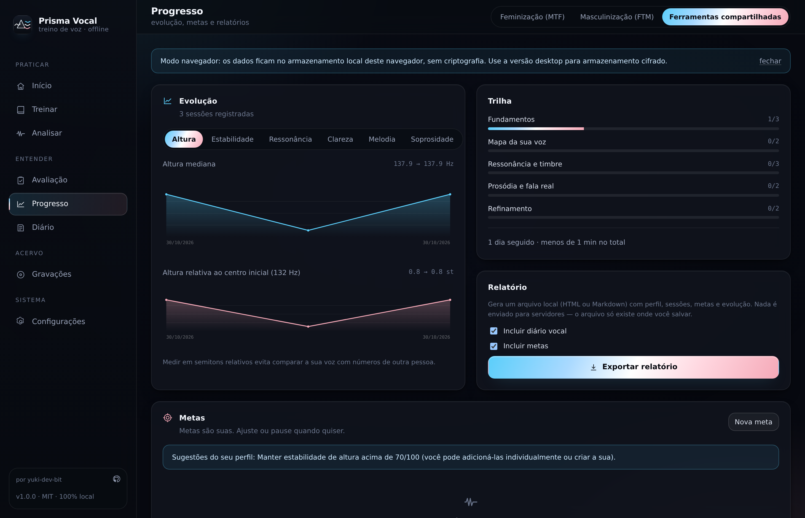
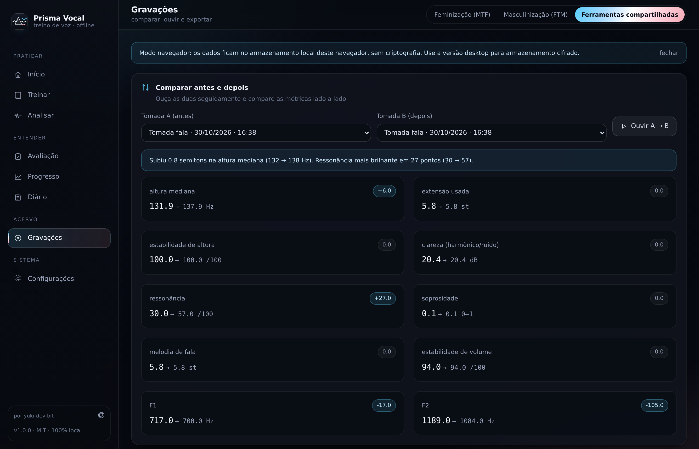

# Prisma Vocal

**Treino, análise e acompanhamento de voz — 100% offline, local e privado.**

Uma ferramenta de mesa (Windows, Linux e macOS) para quem quer explorar, treinar e acompanhar a própria voz: feminização
vocal, masculinização vocal, ou simplesmente entender melhor o que o seu corpo já faz. Nada sai do
seu computador: sem conta, sem nuvem, sem telemetria. O áudio é analisado no próprio dispositivo e
as gravações ficam criptografadas no disco.

[](https://github.com/yuki-dev-bit/prisma-vocal/actions/workflows/ci.yml)
[](LICENSE)


> **Prisma Vocal não é diagnóstico médico.** As medidas são estimativas acústicas para acompanhar a
> *sua* evolução — não avaliam saúde vocal e não dizem como outras pessoas percebem a sua voz. Se
> houver dor, rouquidão persistente ou perda de extensão, procure um(a) fonoaudiólogo(a).

---

## Capturas de tela

| HUD ao vivo | Resultado de uma tomada |
| --- | --- |
|  |  |

| Treino guiado | Avaliação vocal |
| --- | --- |
|  |  |

| Progresso | Comparação A/B de gravações |
| --- | --- |
|  |  |

Mais capturas em `docs/screenshots/` (início, configurações de áudio, acessibilidade, diário).
As imagens foram geradas por `npm run screenshots` com um microfone simulado (um WAV sintético),
para documentar a interface — não são simulações de resultado: o pipeline de DSP é o mesmo que roda
com um microfone real.

---

## O que o app faz

- **HUD de voz em tempo real** — fita de altura (f0) com grade de notas, espectrograma de 18 bandas,
  plano de formantes (F1×F2), medidor de nível com zonas de risco e quatro mostradores de resumo.
- **Análise de tomadas** — grava uma amostra de fala, leitura ou nota sustentada e devolve métricas
  robustas (medianas e percentis, não médias frágeis) + feedback em formato *o que / por que / como*.
- **Trilha de treino** — 11 módulos, 22 aulas e 28 exercícios: respiração, higiene vocal, escuta,
  mapa de tessitura, transições de registro, vogais, brilho, articulação, prosódia, dinâmica e
  blocos específicos de feminização e masculinização.
- **Metas proporcionais a você** — todas as metas de exercício são calculadas sobre a *sua* linha de
  base (semitons a partir do seu centro confortável), não sobre números de outra pessoa.
- **Avaliação vocal em 7 etapas** — piso, centro confortável, teto, extensão usada, quebras de
  registro, controle de brilho e fala encadeada → perfil + sugestões de metas.
- **Diário vocal** — contexto subjetivo (humor, energia, notas, etiquetas) ao lado dos números.
- **Progresso** — gráficos de evolução por métrica, altura relativa em semitons, metas com barra de
  progresso e exportação de relatório HTML/Markdown autocontido.
- **Gravações** — ouvir, comparar duas tomadas A/B com deltas, exportar WAV, apagar.
- **Lembretes locais** e **modo navegador** (com aviso explícito de degradação de privacidade).

## O que o app não faz

- Não envia áudio, métricas ou qualquer dado para servidores — **não há código de rede** no renderer.
- Não avalia saúde vocal, não detecta patologia e não substitui acompanhamento profissional.
- Não promete "passar" por nenhuma voz: o objetivo é o seu conforto, não um padrão externo.
- Não usa modelos de machine learning: é DSP clássico, auditável e determinístico.

---

## Privacidade por desenho

| Aspecto | Como funciona |
| --- | --- |
| Processamento | Áudio analisado no renderer (Web Audio + AudioWorklet). Nada trafega. |
| Gravações | AES-256-GCM, IV aleatório por arquivo, chave de 32 bytes por instalação. |
| Chave | Guardada via `safeStorage` (Keychain / DPAPI / libsecret); se indisponível, arquivo `0600` + aviso na UI. |
| Telemetria | Não existe. O app não faz requisições de rede. |
| Permissões | Apenas microfone. Câmera, tela, localização e notificações de terceiros são negados. |
| Navegação | `will-navigate` bloqueado; links externos passam por allowlist. |
| Exclusão | "Apagar tudo" remove dados + gravações do disco, com confirmação no sistema. |
| Modo navegador | IndexedDB **sem criptografia** — a UI avisa isso permanentemente. Use o app desktop. |

Detalhes e modelo de ameaça em [docs/PRIVACY.md](docs/PRIVACY.md) e [SECURITY.md](SECURITY.md).

---

## Instalação

### Pacotes prontos

Baixe o instalador do seu sistema na página de releases:

- **Linux** — `.AppImage` (portátil) ou `.deb`
- **Windows** — instalador NSIS (`x64` e `arm64`) — passo a passo detalhado em [docs/WINDOWS.md](docs/WINDOWS.md)
- **macOS** — `.dmg` (`x64` e `arm64`)

Ao abrir pela primeira vez, o sistema pede permissão de microfone. O app funciona sem rede.

### A partir do código

Requisitos: **Node.js 22.12+** (LTS recomendado: 22 ou 24) e **npm 10+**. Python 3 com Pillow apenas
para regerar ícones. Versões usadas: Electron 45, React 19, Vite 8, TypeScript 5.7, Vitest 5
(`npm audit` sem vulnerabilidades conhecidas).

```bash
git clone https://github.com/yuki-dev-bit/prisma-vocal.git
cd prisma-vocal
npm install
npm run dev          # Electron + Vite com recarregamento
```

Para rodar só a interface no navegador (sem criptografia):

```bash
npm run dev:web      # http://localhost:5273
```

Gerar o executável do seu sistema:

```bash
npm run dist:linux   # ou dist:win / dist:mac
```

Os artefatos saem em `release/`.

---

## Primeiros passos

1. **Avaliação** → faça o protocolo de 7 etapas (~4 min). É o que cria o seu perfil: piso, centro,
   teto e extensão. Sem ele, as metas de treino aparecem como valores absolutos padrão.
2. **Treinar** → siga a recomendação da tela inicial. O primeiro módulo é respiração e fluxo.
3. **Analisar** → grave uma tomada de fala antes e depois de cada prática. Comparar é onde a
   evolução aparece.
4. **Progresso** → acompanhe altura relativa (em semitons) e ressonância. Evite comparar Hz com
   outras pessoas: compare com você mesmo.
5. **Configurações → Áudio** → ajuste ganho até o pico da fala ficar entre −12 e −6 dBFS.

### Calibração do microfone (opcional, 2 minutos)

A tela inicial convida a calibrar; o convite desaparece depois de feito ou com "Agora não". O que é:

- o app mede volume em **dBFS** (relativo ao máximo digital). Sem calibração, é o único número de
  volume que aparece — e ele só serve para comparar com você mesmo;
- com calibração, o app também estima **dB SPL** (o valor de um decibelímetro). Para isso compara o
  que o microfone lê com o que um medidor externo mostra, uma vez por aparelho e por microfone;
- o procedimento: fique em ambiente silencioso, a ~30 cm do microfone, sustente um "aaa" confortável,
  informe o valor do medidor e confirme. O app mostra o offset calculado (tipicamente 60–105 dB) e a
  data em que a calibração foi salva;
- o valor fica no armazenamento local (criptografado em disco), continua valendo após
  fechar o app ou reiniciar o aparelho, e pode ser refeito ou removido em Configurações → Áudio.
  Trocar de celular, de fone com microfone ou mexer no ganho de entrada em mais de ~6 dB pede nova
  calibração.

Sem calibração os exercícios funcionam igual — o feedback de volume apenas fica em dBFS.

---

## Como as métricas funcionam

| Métrica | Método | O que significa (e o que não significa) |
| --- | --- | --- |
| Altura (f0) | YIN (de Cheveigné & Kawahara, 2002), quadros de 128 ms / hop 16 ms a 16 kHz | Frequência fundamental mediana. Não é "o tom da sua voz" percebido: percepção combina f0, peso e ressonância. |
| Estabilidade | desvio de f0 dentro dos quadros vozeados | Consistência em nota sustentada. Queda pode ser cansaço ou ar irregular. |
| Extensão usada | percentis 5–95 de f0 em semitons | Faixa que você efetivamente usou na tomada, não o seu limite. |
| Ressonância | índice próprio: centroide normalizado pela f0 + energia de presença (2–4 kHz) | Brilho/forward. **Só comparável com você mesmo** — a escala é relativa. |
| Clareza (HNR) | autocorrelação no período (linha de Boersma) | Relação harmônico/ruído. Valores baixos indicam soprosidade ou ambiente ruidoso. |
| Soprosidade | HNR + inclinação espectral + planura + aperiodicidade | Estimativa perceptiva de ar na voz. Sensível a microfone e distância. |
| Formantes (F1–F4) | LPC por autocorrelação + Levinson-Durbin | Cor do timbre e articulação. Estimativas: em f0 alta, F1 pode não ser recuperável. |
| Inclinação espectral | regressão em 200–4000 Hz | Peso/tilt. Varia com microfone — vale a tendência, não o absoluto. |
| Melodia de fala | percentis de f0 em fala encadeada | Expressividade. Não é "cantar bem". |
| Nível | dBFS (RMS) ou dB SPL após calibração | Volume de entrada. Sem calibração é nível digital, não pressão sonora. |

Explicação completa, com fórmulas e limites: [docs/METRICS.md](docs/METRICS.md).

**Decisões deliberadas de honestidade:** metas relativas à sua linha de base; ausência de nota
quando não há meta (a UI mostra "sem nota", nunca 0); `noiseSuppression` do navegador desligado por
padrão (o filtro distorce medidas acústicas); calibração SPL opcional e explícita.

---

## Acessibilidade

- Nenhuma informação depende só de som: tudo tem equivalente visual (fita, espectrograma, números).
- Escala de fonte 85–160%, alto contraste, movimento reduzido, paleta segura para daltonismo.
- Navegação completa por teclado, `skip-link`, modais com foco preso e `Esc`, rótulos ARIA nos
  gráficos com os valores atuais.
- Textos de feedback em linguagem simples, com "o que / por que / como".
- Interface em português (pt-BR) e inglês; conteúdo editorial em português nesta versão.

---

## Segurança

| Camada | Medida |
| --- | --- |
| Renderer | `contextIsolation: true`, `nodeIntegration: false`, `sandbox: true`; sem `eval`, `innerHTML`, `fetch` ou WebSocket. |
| IPC | Todo handler valida que a chamada veio da janela principal (não de um frame qualquer) antes de tocar no disco. |
| Janela | Microfone liberado só para a origem do próprio app; `<webview>` bloqueado; navegação e `window.open` fora da allowlist negados. |
| CSP | Produção: `default-src 'self'`, `script-src 'self'`, `connect-src 'self'`, `object-src 'none'`. O modo de desenvolvimento tem política própria (React Refresh + HMR). |
| Dados | AES-GCM 256 com a chave guardada no cofre do sistema operacional (DPAPI/Keychain/libsecret). |
| Links externos | `openExternal` só abre `https://github.com/yuki-dev-bit` (allowlist). |
| Backups | Exportação JSON sem áudio; "apagar tudo" remove dados **e** a chave de criptografia. |

Detalhes e modelo de ameaça: [docs/PRIVACY.md](docs/PRIVACY.md), [SECURITY.md](SECURITY.md) e
e no repositório do Android ([prisma-vocal-android](https://github.com/yuki-dev-bit/prisma-vocal-android)).

## Arquitetura

```
src/
  core/            DSP e lógica pura (sem React, sem Electron) — 100% testável em Node
    dsp/           FFT, janelas, YIN, LPC, features, WAV, reamostragem
    analysis/      pipeline quadro→métricas, agregação de sessão, comparação A/B
    assessment/    protocolo de avaliação e construção de perfil
    training/      currículo, avaliação de metas, progresso, recomendador
    feedback/      motor de feedback pedagógico
    storage/       migração/saneamento de dados
    reports/       relatório HTML/Markdown autocontido
  audio/           AudioWorklet + AudioEngine + Recorder (Web Audio, no renderer)
  renderer/        React 19: views, HUD em canvas, estado (Context + IndexedDB/IPC)
  shared/          tipos e contrato de IPC
electron/          processo principal: janela, CSP, permissões, cofre, IPC, logs
```

- O **renderer** faz DSP em tempo real: quadros de 16 ms vão para um ring buffer lido por canvas via
  `requestAnimationFrame`; o React só recebe leituras numéricas a 10 Hz.
- O que atravessa o IPC é apenas **persistência e IO** (dados, gravações cifradas, relatórios,
  diálogos). Nenhum handler toca em áudio.
- Mais detalhes: [docs/ARCHITECTURE.md](docs/ARCHITECTURE.md).

---

## Versão Android

O aplicativo de celular é o **mesmo produto** com outro alvo de execução (Capacitor/WebView), e fica
em um repositório separado: **[prisma-vocal-android](https://github.com/yuki-dev-bit/prisma-vocal-android)**.
O renderer de `src/` é compartilhado — as mudanças de interface e de análise valem para os dois.

## Desenvolvimento

```bash
npm run dev          # Electron + Vite (HMR no renderer)
npm run dev:web      # somente navegador
npm run typecheck    # tsc strict nos dois projetos (renderer+core e electron)
npm run lint         # ESLint (typescript-eslint + regras de hooks)
npm run format:check # Prettier
npm test             # vitest: DSP, análise, avaliação, progresso, relatório
npm run test:coverage # os mesmos testes + cobertura de src/core e src/shared (piso em vitest.config.ts)
npm run verify       # typecheck + lint + formatação + cobertura + smoke dos scripts
npm run smoke        # valida o caminho de inicialização e a CSP de desenvolvimento
npm run smoke:mic     # microfone sintético: captura, calibração, persistência após reload, negação
npm run smoke:desktop # Electron real: startup do bundle, fechamento com descarga, reabertura
npm run verify:desktop # build:renderer + smoke:desktop (precisa de display: xvfb-run em Linux)
npm run build        # typecheck + build do renderer e do processo principal
npm run pack:dir     # empacota sem instalador (para inspecionar)
npm run dist         # instaladores da plataforma atual
npm run doctor       # diagnóstico de dependências (Node, Vite, binário do Electron)
npm run icons        # regera ícones (requer Python 3 + Pillow)
npm run screenshots  # capturas do README (requer dev:web rodando)
```

Estrutura de testes: 20 arquivos, **351 testes** cobrindo FFT/YIN/LPC/formantes/WAV, análise
quadro-a-quadro, agregação robusta, avaliação de metas, progresso, currículo, motor de feedback,
recomendação do próximo passo, armazenamento (migração, retenção, limites de histórico), relatórios,
perfil de avaliação, configurações (saneamento de dados corrompidos), i18n, o contrato de IPC, a
versão do app (que precisa acompanhar o `package.json`), as regras de calibração, o manifesto Android
(que precisa declarar as permissões que o Capacitor pede) e o núcleo do processo principal —
geometria da janela, fila de escrita, agendamento de lembretes e porta de fechamento com descarga.
`npm test` não precisa de microfone nem de Electron.

Cobertura medida em `npm run test:coverage`, só sobre `src/core` e `src/shared`:

| Métrica | Medido | Piso (`vitest.config.ts`) |
| --- | --- | --- |
| statements | 97,9% | 95% |
| branches | 91,5% | 88% |
| functions | 99,6% | 97% |
| lines | 99,5% | 97% |

O que **não** entra na conta, e por quê: `src/shared/types.ts` (só tipos, nenhuma linha executável);
`electron/`, o AudioWorklet e o bridge Android (não existem no Node — são cobertos por
`smoke:desktop`, `smoke:android`, `smoke:mic` e `test:mobile`); e a interpolação de variáveis do
`translator` (i18n), que nenhuma string atual usa. Não há `/* v8 ignore */` nem módulo de lógica
escondido do relatório.

```bash
npm run build:renderer
```

> **Sobre as dependências `@capacitor/*`:** o renderer de `src/` é compartilhado com o app Android,
> e `state/bridge-android.ts` importa os plugins nativamente (só em tempo de execução, dentro do
> aparelho). Elas permanecem no `package.json` para que o mesmo código compile e teste nos dois
> repositórios; neste projeto nenhuma delas é usada em execução.

Guia detalhado (padrões de código, como adicionar aulas, como testar áudio): [docs/DEVELOPMENT.md](docs/DEVELOPMENT.md).
Específico de Windows (instalar, microfone, assinatura, problemas): [docs/WINDOWS.md](docs/WINDOWS.md).

---

## Limitações conhecidas

- **Formantes** são estimativas por LPC: em f0 muito alta (> 300 Hz), F1 pode não ser separável do
  harmônico. O app sinaliza isso em vez de inventar número.
- **Ressonância** é índice relativo — não existe (e não inventamos) escala absoluta comparável entre
  pessoas diferentes.
- **Microfone importa**: celular/headset têm resposta irregular; mudar de microfone muda os números.
- **Ruído de fundo** afeta HNR e soprosidade; o modo com gate atenua, mas não corrige.
- **Modo navegador** não criptografa (IndexedDB) e não tem lembretes nativos.
- **macOS/Windows** não foram validados em hardware real durante o desenvolvimento desta versão —
  veja [docs/LIMITATIONS.md](docs/LIMITATIONS.md).

---

## Contribuindo

Contribuições são bem-vindas: correções de DSP, traduções, acessibilidade, textos do currículo e
revisão de linguagem (inclusive revisão por pessoas trans sobre o conteúdo). Leia
[CONTRIBUTING.md](CONTRIBUTING.md) antes de abrir um PR.

Segurança: veja [SECURITY.md](SECURITY.md) para relatar vulnerabilidades em particular.

---

## Licença

MIT © 2026 **yuki-dev-bit** — veja [LICENSE](LICENSE).

Feito com cuidado para ser uma ferramenta que respeita quem usa: sem conta, sem vigilância, sem
promessa de padronização. Se este projeto te ajudar, compartilhe com quem também pode precisar.
